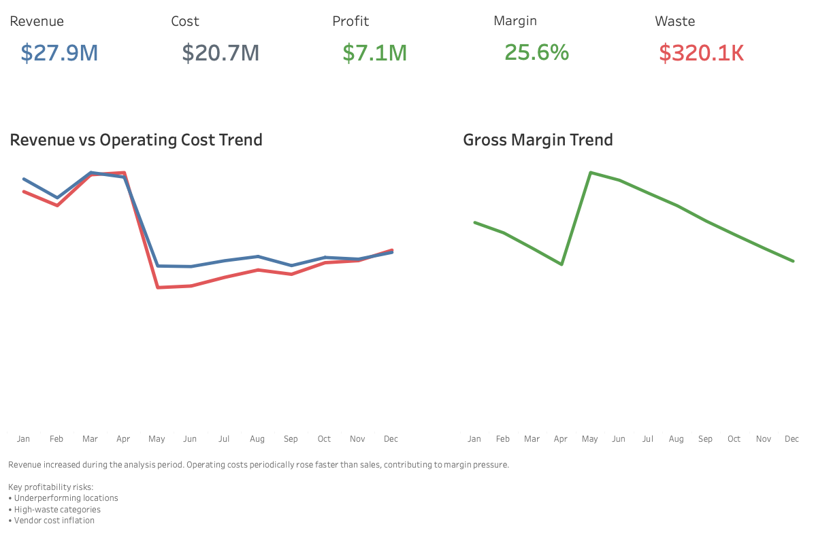
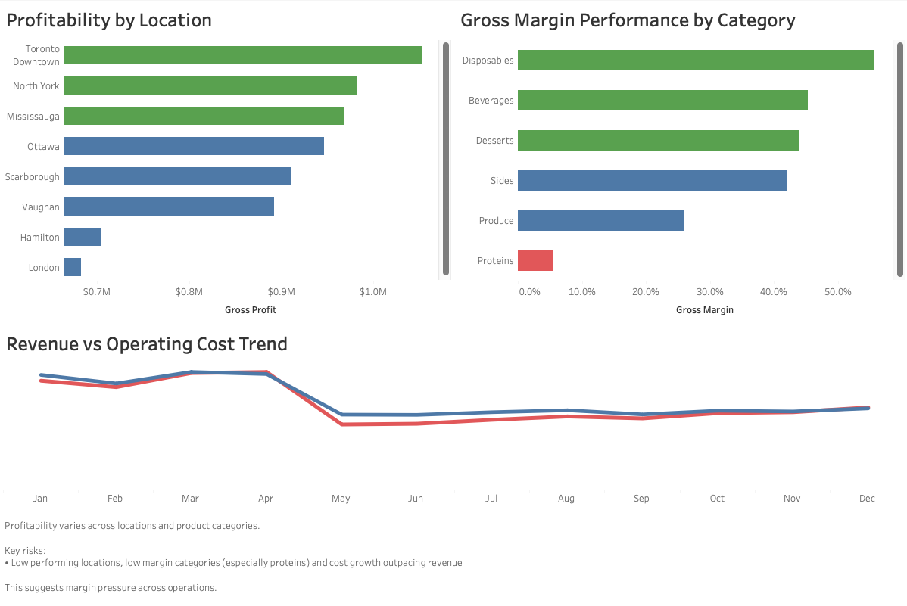
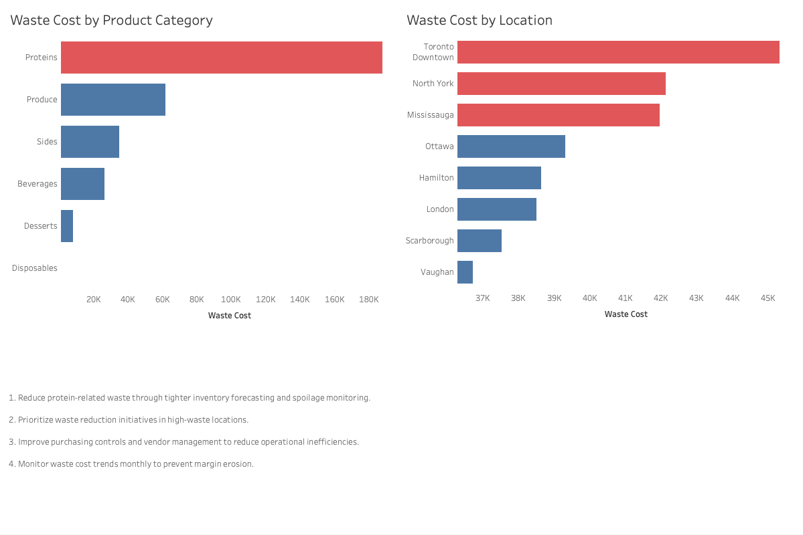
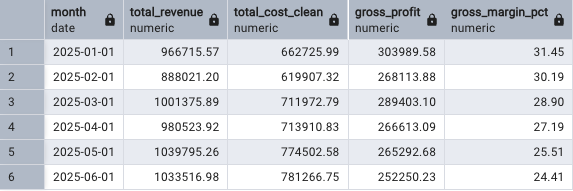
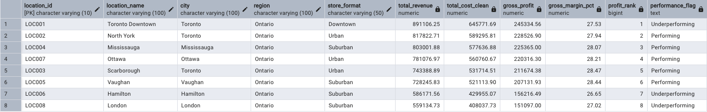
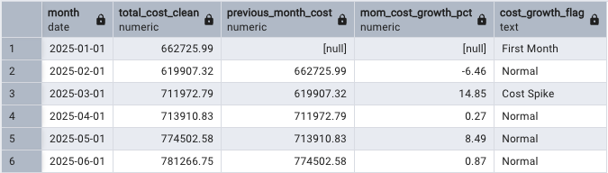

# Operations Profitability & Cost Optimization

**Gross margin fell from 31.45% to 24.41% while revenue held steady. This analysis traces the loss to rising costs, a +14.85% March cost spike, and two underperforming locations.**

    

**[View the live Tableau dashboard](https://public.tableau.com/app/profile/julio.carneiro/viz/OperationsProfitabilityCostOptimization/ExecutiveSummary)**

---

## Business problem

A multi-location restaurant group sees stable revenue but shrinking profit. Leadership needs to know:

> **Where is profitability being lost, why is it happening, and what should we prioritize?**

- Which locations are most and least profitable?
- Are costs growing faster than revenue?
- Which product categories underperform?
- What actions should leadership take first?

## Approach

1. **Validate the data** with a SQL validation framework (missing values, duplicates, negative values, orphan keys, date consistency, join coverage, cost reconciliation).
2. **Clean** the two reconciliation issues found, recalculating total cost from its components.
3. **Analyze in SQL**: monthly profitability, location performance, and month-over-month cost growth using the `LAG()` window function.
4. **Prepare the dashboard dataset** in Python (pandas).
5. **Build an executive dashboard** in Tableau with three pages: Executive Summary, Profitability Drivers, Waste & Action Priorities.

The dataset is synthetic, generated in `notebooks/00_data_generation.ipynb` to model a realistic restaurant group.

## Key findings

| Finding | Number | What it means |
|---|---:|---|
| Gross margin compression | 31.45% → 24.41% | Profit is falling even though sales are not |
| Monthly revenue range | $888K – $1.04M | Revenue is stable, so the problem is cost |
| March cost spike | +14.85% MoM | One month drove a large share of the margin loss |
| Weakest locations | Hamilton, London | Below average on both profit and margin |
| Highest-profit location | Toronto Downtown | Most profit, but lower efficiency, so savings are still available |
| Data issues fixed | 553 + 139 rows | Cost components did not add up; vendor cost % mismatched |

### Recommendations

| Priority | Action |
|---|---|
| High | Investigate the drivers behind the March cost spike |
| High | Audit cost structures in high-revenue locations |
| Medium | Optimize labor and overhead allocation |
| Medium | Improve vendor cost monitoring |
| Low | Review pricing if margin compression continues |

## Visuals

**Executive Summary**


**Profitability Drivers**


**Waste & Action Priorities**


<details>
<summary>SQL analysis outputs and validation results</summary>

**Monthly profitability**


**Location performance**


**Month-over-month cost growth**


**Validation summary**


**Validation failures**


</details>

## How to run

1. **Database:** create a PostgreSQL database and run the scripts in `sql/` in order (`00` to `05`). After `01_create_tables.sql`, import the CSVs from `data/raw/` into the matching tables (pgAdmin's Import tool or `\copy`).
2. **Notebooks:** the notebooks were built in Google Colab. To run locally:
   ```bash
   pip install -r requirements.txt
   jupyter notebook notebooks/
   ```
   Skip the Google Drive mount cell and point the paths to `data/`.
3. **Dashboard:** open `dashboard/tableau/Operations Profitability & Cost Optimization.twbx` in Tableau, or use the live link above.

## Folder structure

```text
operations-profitability-cost-optimization/
├── data/
│   ├── raw/                  # sales, costs, locations, products, vendor prices, waste
│   ├── cleaned/              # validated, dashboard-ready data
│   └── data_dictionary.csv
├── sql/                      # 00 validation → 05 cost growth
├── notebooks/                # 00 data generation, 01 validation, 02 dashboard dataset
├── outputs/                  # SQL query results (CSV)
├── images/                   # charts for this README
├── dashboard/
│   ├── tableau/              # Tableau workbook (.twbx)
│   └── dashboard-screenshots/
└── assets/                   # banner
```

## Contact

**Julio Carneiro** · Data Analyst · Toronto, ON
[LinkedIn](https://www.linkedin.com/in/juliocezarcarneiro/) · [Portfolio](https://github.com/juliocezarcarneiro) · [Email](mailto:juliocezarcarneiro@outlook.com)
